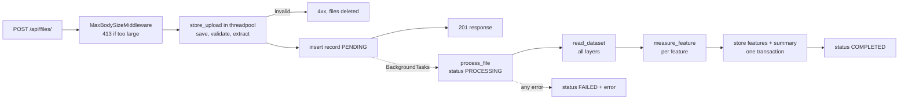

# Geospatial File Measurement API

A FastAPI service that accepts a Shapefile (as a `.zip`) or a `.kml` file, reads every
feature in it, and measures each one in metres: area and perimeter for polygons, length for
lines. Each feature is reprojected to the UTM zone it sits in, with a geodesic fallback where
UTM would be inaccurate. Uploads are validated straight away, processed in the background,
and the results are stored in SQL so clients can poll for them.

**Stack:** Python 3.13, FastAPI, GeoPandas / pyogrio (GDAL) / Shapely / pyproj,
SQLAlchemy 2 + SQLite, Docker, pytest (130 tests).

## Quick start

Docker is the only requirement. GDAL and PROJ come bundled in the Python wheels.

```bash
docker compose up --build          # API on http://localhost:8000, Swagger UI at /docs
docker compose run --rm tests      # run the test suite in a container (builds the test image on first use)
```

`docker compose down` stops the API but keeps the `uploads` and `data` volumes;
`docker compose down -v` deletes them as well.

### Without Docker (tested on Python 3.13)

```bash
python3 -m venv .venv && source .venv/bin/activate
pip install -r requirements-dev.txt   # no system GIS libraries needed
uvicorn app.main:app --reload         # creates ./data/app.db and ./uploads/
pytest
```

### Configuration

All settings are environment variables with the `GEO_` prefix (a `.env` file also works).

| Variable | Default | Meaning |
|---|---|---|
| `GEO_UPLOAD_DIR` | `uploads` | Where uploaded and extracted files are stored |
| `GEO_DATABASE_URL` | `sqlite:///./data/app.db` | SQLAlchemy URL. Any backend works, e.g. `postgresql+psycopg://…` once a driver is installed |
| `GEO_MAX_UPLOAD_SIZE_MB` | `50` | Maximum upload size |
| `GEO_MAX_EXTRACTED_SIZE_MB` | `500` | Maximum total uncompressed size of a zip's contents |
| `GEO_MAX_ZIP_ENTRIES` | `1000` | Maximum number of entries in a zip |
| `GEO_DEFAULT_CRS` | unset | CRS to assume when a file has none (e.g. a shapefile without `.prj`). When unset, such files fail. The value is checked at startup |
| `GEO_APP_NAME` | `Geospatial File Measurement API` | Title shown in the OpenAPI docs |

## API

| Method | Path | Description |
|---|---|---|
| `POST` | `/api/files/` | Upload a `.zip` (Shapefile) or `.kml`. Validates it and returns `201` with status `PENDING` |
| `GET` | `/api/files/{id}/` | File info and processing status |
| `GET` | `/api/files/{id}/measurements/` | Per-feature measurements and a summary (`?offset=&limit=`) |
| `GET` | `/health` | Liveness check (used by the Docker healthcheck) |

Interactive docs: http://localhost:8000/docs (OpenAPI schema at `/openapi.json`).
Paths end in a slash, as in the spec. Without it FastAPI answers `307` to the slashed URL,
so with curl add `-L` or include the slash.

### Flow: upload, poll, fetch

Processing runs after the upload response has been sent, so a client polls the status:

```
POST /api/files/                 -> 201  status: PENDING
GET  /api/files/{id}/            -> 200  status: PENDING | PROCESSING | COMPLETED | FAILED
GET  /api/files/{id}/measurements/ -> 200 once COMPLETED, 409 before that or if FAILED
```

The examples below are real responses from the Docker container. The upload is a small KML
with a polygon ("Farm", 0.01° × 0.01° near Bengaluru), a line ("Road") and a point ("Well").

**Upload**

```bash
curl -F "file=@survey.kml" http://localhost:8000/api/files/
```

```json
{
  "id": "2c9a34fa45b24fa1891397d2b99faa5d",
  "filename": "survey.kml",
  "feature_count": null,
  "crs": null,
  "status": "PENDING",
  "error": null,
  "warnings": [],
  "created_at": "2026-10-10T16:10:20.186573Z",
  "processed_at": null
}
```

**File info** (about 0.1 s later)

```bash
curl http://localhost:8000/api/files/2c9a34fa45b24fa1891397d2b99faa5d/
```

```json
{
  "id": "2c9a34fa45b24fa1891397d2b99faa5d",
  "filename": "survey.kml",
  "feature_count": 3,
  "crs": "EPSG:4326",
  "status": "COMPLETED",
  "error": null,
  "warnings": [],
  "created_at": "2026-10-10T16:10:20.186573Z",
  "processed_at": "2026-10-10T16:10:20.287658Z"
}
```

`crs` is the file's own CRS (`null` if its layers disagree, which also adds a warning).
`warnings` lists non-fatal issues, such as GDAL warnings or an assumed `GEO_DEFAULT_CRS`.
If processing fails, `status` is `FAILED` and `error` gives the reason.

**Measurements**

```bash
curl http://localhost:8000/api/files/2c9a34fa45b24fa1891397d2b99faa5d/measurements/
```

```json
{
  "file_id": "2c9a34fa45b24fa1891397d2b99faa5d",
  "crs": "EPSG:4326",
  "total": 3,
  "offset": 0,
  "limit": null,
  "summary": {
    "geometry_types": { "Polygon": 1, "LineString": 1, "Point": 1 },
    "without_geometry": 0,
    "measured": 2,
    "total_area_m2": 1201683.9190971013,
    "total_length_m": 2304.202941046659
  },
  "features": [
    {
      "id": 0,
      "layer": "Survey",
      "geometry_type": "Polygon",
      "geometry": { "type": "Polygon", "coordinates": [[[77.59, 12.97], [77.6, 12.97], [77.6, 12.98], [77.59, 12.98], [77.59, 12.97]]] },
      "crs": "EPSG:4326",
      "properties": { "Name": "Farm", "description": "Main field" },
      "area_m2": 1201683.9190971013,
      "perimeter_m": 4385.06186419692,
      "length_m": null,
      "measurement_crs": "EPSG:32643",
      "method": "projected",
      "note": null
    },
    {
      "id": 1,
      "layer": "Survey",
      "geometry_type": "LineString",
      "geometry": { "type": "LineString", "coordinates": [[77.59, 12.965], [77.6, 12.965], [77.61, 12.97]] },
      "crs": "EPSG:4326",
      "properties": { "Name": "Road" },
      "area_m2": null,
      "perimeter_m": null,
      "length_m": 2304.202941046659,
      "measurement_crs": "EPSG:32643",
      "method": "projected",
      "note": null
    },
    {
      "id": 2,
      "layer": "Survey",
      "geometry_type": "Point",
      "geometry": { "type": "Point", "coordinates": [77.595, 12.975] },
      "crs": "EPSG:4326",
      "properties": { "Name": "Well" },
      "area_m2": null,
      "perimeter_m": null,
      "length_m": null,
      "measurement_crs": null,
      "method": null,
      "note": "No measurement for Point geometries"
    }
  ]
}
```

| Feature field | Meaning |
|---|---|
| `id` | Position in the file across all layers, from 0 |
| `layer` | Layer name (a KML `<Document>`/`<Folder>`, or the shapefile name) |
| `geometry`, `crs` | Original GeoJSON geometry, in the file's own CRS (never reprojected) |
| `properties` | Attributes, converted to strict JSON. KML styling fields are dropped |
| `area_m2`, `perimeter_m` | Polygons and multipolygons. The perimeter includes the edges of holes |
| `length_m` | Lines and multilines |
| `measurement_crs` | The CRS the numbers were computed in, e.g. `EPSG:32643` (UTM 43N), or `EPSG:4326 (geodesic)` |
| `method` | `projected` (local UTM) or `geodesic` (on the WGS84 ellipsoid) |
| `note` | Why nothing was measured, or that an invalid geometry was repaired first |

**Features that can't be measured** still appear, with `null` measurements and a `note`:
points and multipoints ("No measurement for Point geometries"), placemarks without geometry
("Feature has no geometry"), empty geometries, and coordinates outside the CRS's valid range.
A bad feature never fails the whole file. A `GeometryCollection` gets the sum of its polygon
areas and line lengths.

**Pagination:** `offset` (default 0) and `limit` (default all, maximum 10,000). `total` and
`summary` always cover the whole file, not just the current page.

### Status codes

| Code | When |
|---|---|
| `201` | Upload accepted (status `PENDING`) |
| `400` | Empty file, malformed or non-KML XML, XML entities (XXE), corrupt, encrypted or unsafe zip, or a zip without exactly one complete shapefile |
| `404` | Unknown file id |
| `409` | Measurements requested while `PENDING`/`PROCESSING`, or after `FAILED` (the detail says which, and why it failed) |
| `413` | Upload over `GEO_MAX_UPLOAD_SIZE_MB`, or zip contents over `GEO_MAX_EXTRACTED_SIZE_MB` |
| `415` | Extension other than `.zip` / `.kml` |
| `422` | Request validation, e.g. no `file` field, `limit=0`, `offset=-1` |

Errors use FastAPI's format, e.g. `{"detail": "Unsupported file type '.txt'. Upload a .zip (Shapefile) or .kml file."}`.

## Architecture

```
app/
├── main.py              # App, lifespan (create tables, fail interrupted files), /health
├── core/config.py       # Settings from GEO_* env vars
├── db.py                # Engine factory; SQLite pragmas (WAL, foreign keys, busy timeout)
├── models.py            # SQLAlchemy tables: files, features
├── api/
│   ├── middleware.py    # Rejects oversized request bodies before they're received
│   ├── router.py        # Mounts routers under /api
│   └── routes/files.py  # The three endpoints
├── schemas/files.py     # Pydantic response models (FileInfo, FeatureMeasurement, …)
└── services/
    ├── uploads.py       # save + validate + clean up on any failure (runs in a worker thread)
    ├── storage.py       # Chunked copy to disk with a size limit; filename sanitising
    ├── validation.py    # Extension, KML (defusedxml) and shapefile-zip checks, safe extraction
    ├── processing.py    # Reads every layer/feature with pyogrio; JSON-safe properties
    ├── measurement.py   # CRS handling and area/perimeter/length for one geometry
    ├── pipeline.py      # process_file(): read, measure, store, set status (framework-agnostic)
    └── repository.py    # SQL repository; speaks Pydantic models only
tests/                   # 130 pytest tests
```

### Request and processing flow



1. **Size limit:** a pure ASGI middleware rejects a request whose `Content-Length` exceeds
   the limit before reading any of the body. For chunked uploads it counts bytes as they arrive.
2. **Validation** (save, then check, then extract the shapefile) is blocking code, so the
   route runs it in a worker thread with `run_in_threadpool`. If it fails, the upload folder is
   deleted, whatever the error.
3. **Record:** a `PENDING` row is inserted and the `201` is sent.
4. **Processing:** `process_file` runs as a `BackgroundTask`. It is a sync function, so it
   runs in a worker thread, not on the event loop. It reads all layers with pyogrio, measures
   each feature, writes all feature rows and the summary in one transaction, and only then
   sets `COMPLETED`. A client that sees `COMPLETED` is therefore guaranteed to find the data.
   Expected problems (unreadable file, missing CRS) set `FAILED` with a readable message.
   Unexpected ones set a generic message and log the traceback. Either way the status never
   stays at `PROCESSING`.
5. **Restart recovery:** at startup, any file left `PENDING`/`PROCESSING` by a previous run
   is marked `FAILED` ("interrupted by a server restart"), so clients don't poll forever.

### Measurement flow (`measure_feature`)

1. Drop Z/M (measurements are 2D) and split the geometry into polygon and line parts. Points are ignored.
2. If the geometry is invalid, repair it with `shapely.make_valid` (polygons use
   `method="structure"`, so overlapping multipolygon parts are counted once) and add a note.
3. **Densify** long edges in the source CRS's own units, every 0.1° or 10 km.
4. Transform to WGS84 longitude/latitude, then pick a UTM zone or fall back to geodesic (below).
5. Projected: planar `area`/`length` in the UTM zone. Geodesic: `pyproj.Geod` ring by ring,
   with holes subtracted whatever their winding order.
6. Reject any non-finite result. Expected pyproj/GEOS errors become a `note`, and anything
   else raises, because it is a bug.

### CRS handling

- **Each feature gets its own local UTM zone**, chosen from its centroid
  (`zone = floor((lon + 180) / 6) + 1`; EPSG 326xx north, 327xx south). This applies **whatever
  the source CRS is**, including projected ones. Web Mercator (EPSG:3857) inflates areas about
  4× at 60° latitude, and State Plane CRSs can be in US feet. Both are tested. For data already
  in the matching UTM zone, the conversion is effectively a no-op.
- **Geodesic fallback** (WGS84 ellipsoid) is used when no single zone fits:
  - any vertex is more than **0.1 rad** (about 640 km, ≈ Δlon · cos(lat)) from the zone's
    central meridian. UTM scale is k ≈ 0.9996 (1 + x²/2), so at that limit the worst vertex
    has under 0.5% length error (about 1% area). Using the scaled distance means high-latitude
    features aren't sent to geodesic unnecessarily;
  - the feature crosses the antimeridian (longitude span > 180°, or |lon| ≥ 180). Fiji and
    Russia are stored as parts on both sides of 180°, so their centroid lands near 0°;
  - it extends outside UTM's 80°S to 84°N range.
- **Densifying before reprojecting:** an edge is straight in its own CRS but curved in
  another. Without densifying, a 20° × 10° box was off by 0.5%. With it, the box agrees with a
  finely segmented geodesic reference within 0.05%. Real files changed by 0.02% or less,
  because they are already dense.
- **KML** is always EPSG:4326 (the format defines it). **Shapefiles** use their `.prj`. If
  the `.prj` is missing, processing fails with a clear error unless `GEO_DEFAULT_CRS` is set,
  in which case that CRS is assumed and a warning is recorded.
- Geometries are stored and returned in the **source CRS**. Reprojection happens only on a
  copy, for measuring.

### Upload validation and security

Validation runs before any GDAL parsing.

| Check | Status |
|---|---|
| Extension is not `.zip` / `.kml` (case-insensitive) | `415` |
| Body larger than the limit: rejected by middleware as it arrives, and checked again while saving | `413` |
| Empty file | `400` |
| KML is not well-formed XML, has no `<kml>` root, or declares entities (XXE, "billion laughs"), via `defusedxml` | `400` |
| Zip is corrupt or encrypted, or contains `..`/absolute paths (zip slip) | `400` |
| Zip has more than `GEO_MAX_ZIP_ENTRIES` entries | `400` |
| Zip's declared uncompressed size exceeds `GEO_MAX_EXTRACTED_SIZE_MB` (zip bomb) | `413` |
| Zip has no `.shp`, more than one, or the `.shp` lacks a `.shx`/`.dbf` in the same folder | `400` |

The shapefile's components are extracted flat under fixed names, never to the archive's own
paths. `__MACOSX/` and hidden files are ignored, shapefiles may be in a subfolder, and
uppercase extensions are accepted. Client filenames are reduced to their base name
(`../../x.kml` becomes `x.kml`). Server paths are stripped from GDAL error messages before
they reach clients. A missing `.prj` is allowed at upload time and handled during processing.

### Database

SQLAlchemy 2 with SQLite by default. The schema is created at startup.

```
files     id (uuid hex, PK), filename, status (indexed), feature_count, crs, error,
          warnings JSON, summary JSON, created_at, processed_at (UTC)
features  PK (file_id → files.id ON DELETE CASCADE, feature_index),
          layer, geometry_type, geometry JSON (GeoJSON), crs, properties JSON,
          area_m2, perimeter_m, length_m, measurement_crs, method, note
```

The composite primary key is the index that the paginated query
(`WHERE file_id = ? ORDER BY feature_index LIMIT/OFFSET`) needs. SQLite runs with WAL mode,
so status polls aren't blocked while measurements are written. It also has foreign keys
enabled and a 5 s busy timeout. JSON is written strictly, so NaN/Infinity can never be stored
or returned. Data survives a container restart: the measurements response was byte-identical
before and after `docker compose restart api`.

## Accuracy checks on real data

Uploaded through the running container. All of these files completed without errors.

| Data | Result |
|---|---|
| US Census states (`cb_2023_us_state_20m`, EPSG:4269, 52 features) | Inland states match official `ALAND + AWATER` closely: Colorado −0.01%, Utah −0.02%, Nevada −0.04%, Kansas +0.05%, Wyoming +0.10%. 50 states fall in 11 UTM zones. Texas (too wide for one zone) and Alaska (crosses 180°) fall back to geodesic |
| Coastal states in the same file | Michigan −39%, Hawaii −41% against the official total. The cartographic boundary file is clipped to the shoreline, while the official water area includes Great Lakes and coastal water. Against land area alone, Hawaii is +0.9% |
| Natural Earth countries (1:110m, 177 features) | 113 projected, 64 geodesic. Russia 17.02M km² geodesic (official about 17.1M, with coarse data). Fiji, which crosses 180°, is handled geodesically |
| Google `KML_Samples.kml` | 10 layers, 21 features (16 measured, 4 points, 1 without geometry). The Pentagon is 120,946 m² |
| Natural Earth rivers / populated places | 13 lines measured (10 geodesic) / 243 points with notes |
| The square in the example above | 1,201,684 m² in UTM 43N vs 1,200,290 m² geodesic (+0.12%). The square is 2.6° from the zone's central meridian, where UTM scale is about 1.0006 (see Limitations) |

### Tests

```bash
pytest                       # locally: 130 passed
docker compose run --rm tests
```

| File | Tests | Covers |
|---|---|---|
| `test_measurement.py` | 40 | UTM vs geodesic choice, same area across 4326/4269/3857/32643/24383, Mercator and US-feet inputs, holes, overlaps, antimeridian, poles, densification, repair, Z, broken coordinates |
| `test_upload_validation.py` | 28 | The validation rules (zip slip, zip bomb, XXE, missing components, …), middleware 413 (with and without `Content-Length`), cleanup on errors |
| `test_processing.py` | 24 | Shapefile/KML reading, nested KML folders, CRS preservation, missing `.prj`, JSON-safe properties |
| `test_pipeline.py` | 17 | Upload-to-measurements end to end, FAILED paths and 409s, pagination, non-finite coordinates |
| `test_repository.py` | 17 | Round trips, atomic replace, cascade delete, restart recovery, persistence, concurrent read/write |
| `test_files_api.py` | 4 | Health, upload/info, 404, failed file |

## Design decisions

| Decision | Alternatives considered | Why |
|---|---|---|
| **FastAPI** | Django + DRF | A small JSON API with no admin, auth or templates. FastAPI gives typed request/response models, OpenAPI docs, and background tasks with little code |
| **Per-feature local UTM, geodesic fallback** | One CRS for the whole file; an equal-area projection; geodesic for everything | One zone per file measures distant features badly (the US-states file spans 11 zones). Equal-area projections preserve area but distort lengths. The spec asks for a projected CRS, and UTM is standard, accurate for both area and length at local scale, and gives a reportable EPSG code. Geodesic covers only the cases UTM can't |
| **`BackgroundTasks` + status polling** | Process inside the request; Celery or RQ with Redis | Uploads return in tens of milliseconds whatever the file size, with no new infrastructure. `process_file` has no FastAPI dependency, so moving to a queue means changing one line (`add_task` to `queue.enqueue`) |
| **Validation in a threadpool, synchronously** | Validate in the background job | A bad file should get an immediate 4xx with a specific reason, not a later `FAILED`. Running it in a thread keeps the event loop free |
| **Size limit in ASGI middleware** | Check inside the route; rely only on a proxy | FastAPI parses the whole multipart body before the route runs, so only middleware can stop a 5 GB upload early. A proxy limit (`client_max_body_size`) is still worth adding in production |
| **409 for not-ready and failed measurements** | 202 Accepted; 200 with an empty list | The resource exists but isn't in a state to return measurements. An empty 200 would look like a file with no features |
| **Fail on a missing CRS** | Assume EPSG:4326 | A wrong guess gives silently wrong areas. Assuming a CRS is available as opt-in via `GEO_DEFAULT_CRS` |
| **SQLite via SQLAlchemy** | Postgres; in-memory dict | No setup for reviewers, and data survives restarts. The queries are portable, so Postgres is a URL change |
| **JSON columns for properties and geometry** | Normalised attribute tables | Every file has a different schema, and properties are always returned whole. On Postgres these would become JSONB |
| **No PostGIS (yet)** | PostGIS geometry columns | Measuring happens in Python and there are no spatial queries. Features keep their own CRS, while a geometry column expects one SRID |
| **Read every layer** | `geopandas.read_file()` default | GDAL makes each KML folder a separate layer, and the default reads only the first. On Google's sample file that drops 18 of 21 features |
| **Keep geometry in the source CRS** | Store everything as EPSG:4326 | The API returns what the user uploaded, and data already in metres avoids a needless round trip |

## Limitations

- **Background tasks aren't durable.** A restart loses in-flight work. Recovery marks those
  files `FAILED`, but they aren't retried.
- **Single-process assumptions.** Restart recovery would also fail files that another API
  process is still working on. Background work shares the default 40-thread pool with sync
  routes.
- **GIL contention.** Processing is partly pure Python, so other requests can see latency
  spikes while a large file is being processed in the same process.
- **SQLite allows a single writer**, which is fine for one process but not for many workers.
- **UTM scale error isn't corrected.** Near a zone's edge, lengths read about 0.1% long
  (area about 0.2%). At the 0.1 rad cut-off, the worst vertex reaches about 0.5% (area about 1%).
- No authentication or rate limiting. Uploads are never cleaned up after processing.
- `OFFSET` pagination slows down for deep pages. Whole files are read into memory (fine under
  the 50 MB limit).
- Only `.kml` and zipped Shapefiles are supported (no KMZ, GeoJSON or GeoPackage), with one
  shapefile per zip.

## Learnings

- **Degrees aren't a unit of distance, and "projected" doesn't mean "good for measuring."**
  Web Mercator is projected and still inflates area 4× at 60°. That is why every feature goes
  to its own UTM zone, not just the ones in lat/lon.
- **Real files beat assumptions.** KML folders become separate GDAL layers, and
  `read_file` silently reads only the first. Real archives also contain `__MACOSX/`, uppercase
  extensions and NaN properties. I found each of these by running real downloads.
- **FastAPI parses multipart bodies before the route runs**, so a size check in the route
  only fires after the whole upload has been received. It has to be middleware.
- **Sync code inside `async def` blocks everything.** I measured it: `/health` took 1.08 s
  (instead of 0.06 s) while a zip was being validated, and 0.014 s after moving validation to
  a thread.
- **Densify before reprojecting.** Straight edges curve in another CRS. Leaving out this
  one-line `segmentize` cost 0.5% on large shapes.
- **"Wrong" numbers can be the reference's fault.** A 39% gap for Michigan came from
  shoreline-clipped boundaries compared against official areas that include water, not from
  the maths.

## Future scope

- **Workers:** Redis + RQ/Celery worker processes with retries and heartbeats. This removes
  the durability, GIL and thread-pool limits.
- **Storage:** S3 or other object storage for uploads, so workers on other machines can read
  them. Add a retention and cleanup job.
- **Database:** Postgres plus Alembic migrations. Later PostGIS for spatial queries
  (bounding-box filters, intersections).
- **Formats:** KMZ, GeoJSON, GeoPackage, and zips with several shapefiles or layers.
- **Accuracy:** correct for UTM scale error with the local scale factor (`pyproj` `get_factors`).
- **API:** keyset pagination (`feature_index > last_seen`), authentication, rate limiting,
  and a delete endpoint.
- **Large files:** chunked reading (`pyogrio` `skip_features`/`max_features`) and streaming
  inserts.
- **Operations:** structured logging (the app's log lines aren't configured to show under
  uvicorn yet), metrics and tracing, then a deployed demo.
